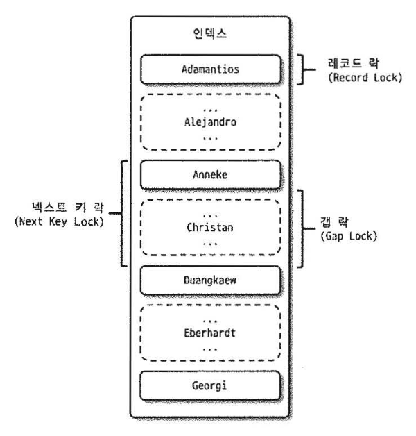
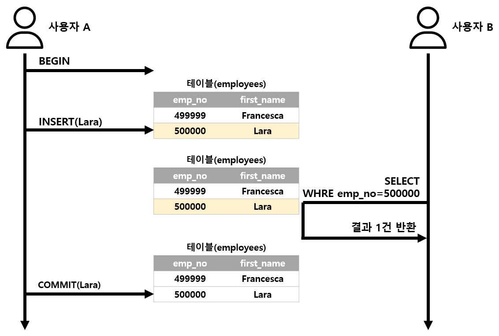
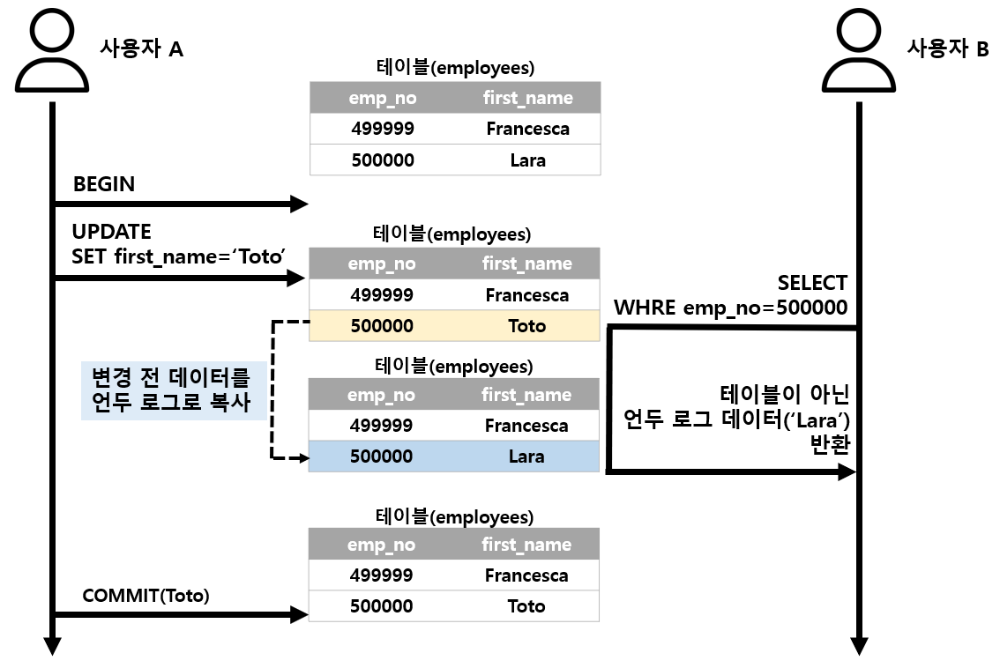
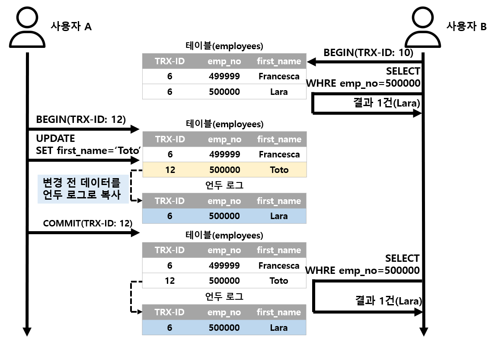

- 잠금과 트랜잭션은 비슷한 개념 같지만 잠금은 동시성을 제어하기 위한 기능이고, 트랜잭션은 데이터 정합성을 보장하기 위한 기능이다

## 1. 트랜잭션

### 1. MySQL에서의 트랜잭션
- 두 개 이상의 쿼리와 상관없이 논리적인 작업이 적용되거나(commit) 적용되지 않아야(rollback)함을 보장해 주는 것이다
- 트랜잭션이 없다면 부분 업데이트가 발생하게 되고 이는 데이터 정합성을 맞추는데 상당히 어려워진다

### 2. 주의사항
- 트랜잭션의 범위는 최소화하는 것이 좋다
- 모든 곳에 트랜잭션을 포함시키면 여유 커넥션 개수도 줄어들고, 외부와 통신하는 경우에는 DBMS서버까지 위험해질 가능성이 있다

## 2. MySQL 엔진의 잠금
- 크게 스토리지 엔진과 MySQL 엔젠 레벨로 나눌 수 있다
  - MySQL 엔진 레벨 잠금은 모든 스토리지 엔진에 영향을 끼치지만, 스토리지 엔젠 잠금은 스토리지 엔진 간 상호 영향을 미치지 않는다
- MySQL 엔진 잠금
  - 테이블 락
  - 메타데이터 락
  - 네임드 락

### 1. 글로버 락
- `FLUSH TABLES WITH READ LOCK`명령으로 획득할 수 있으며 잠금 중 가장 범위가 크다
- 한 세션에서 글로벌 락을 획득하면 SELECT를 제외한 대부분의 DDL문장이나 DML 문장은 대기해야 된다
- 글로벌 락이 영향을 미치는 범위는 MySQL 서버 전체이며, 작업 대상 테이블이나 데이터베이스가 다르더라도 동일하게 영향을 미친다
- MySQL 서버에 존재하는 모든 테이블에 잠금을 건다
- 이는 InnoDB가 트랜잭션을 지원해서 일관된 데이터 상태를 위해 모든 데이터 변경 작업을 멈출 필요가 없어져 가벼운 글로벌 락의 필요성이 생겼다
  - Xtrabackup이나 Enterprise Backup같은 백업 툴들의 안정적인 실행을 위해 백업 락이 도입됐다

> #### 백업 락
> 특정 세션에서 백업락을 획득하면 다음과 같이 테이블의 스키마나 사용자의 인증 관련 정보를 변경할 수 없게 된다 <br>
> 데이터베이스 및 테이블의 모든 객체 생성 및 변경 삭제 <br>
> REPAIR TABLE과 OPTIMIZE TABLE 명령
> 사용자 관리 및 비밀번호 변경
> 일반적인 데이터 변경은 허용된다

### 2. 테이블 락
- 개별 테이블 단위로 설정되는 잠금이며, 명시적 또는 묵시적으로 락을 획득할 수 있다
- `LOCK TABLES table_name [ READ | WRITE ]`명령으로 획득할 수 있지만 특별한 상황이 아니면 사용하지 않는 것이 좋다
- 묵시적인 테이블 락은 `MyISAM`이나 `MEMORY` 테이블에 데이터를 변경하는 쿼리를 실행하면 발생한다
  - `InnoDB`의 경우에 레코드 기반 잠금을 제공하기 때문에 데이터 변경에서는 일어나지 않고 DDL의 경우에만 영향을 미친다

### 3. 네임드 락
- `GET_LCOK()`함수를 이용해 임의의 문자열에 대해 잠금을 설정할 수 있다
- 단순히 사용자가 지정한 문자열(String)에 대해 획득하고 반납(해제)하는 잠금이다
- 자주 사용되지는 않고 5대의 웹서버가 정보를 동기화해야 하는 요건처럼 필요할 때 사용할 수 있다

```sql
-- 중첩해서 사용할 수 있고 한 번에 모두 해제하는 기능도 추가됐다
SELECT GET_LOCK('mylock_1', 10);
SELECT GET_LOCK('mylock_2', 10);

SELECT RELEASE_ALL_LOCKS();
```

### 4. 메타데이터 락
- 데이터베이스 객체(대표적으로 테이블이나 뷰 등)의 이름이나 구조를 변경하는 경우에 획득하는 잠금이다
- 명시적으로 획득할 수는 없고 `RENAME TABLE tab_a TO tab_b`테이블 이름을 변경하는 경우 같이 자동으로 획득하는 잠금이다

## 3. InnoDB 스토리지 엔진 잠금
- 레코드 기반 잠금 방식으로 MyISAM 보다 훨씬 뛰어난 동시성 처리를 할 수 있지만 이원화된 잠금 처리 탓에 잠금에 대한 정보는 MysQL 명령을 이용해 접근하기가 상당히 까다롭다
- 최근에 잠금과 트랜잭션, 잠금 대기중인 목록을 조회할 수 있는 방법이 도입됐다
  - `information_schema`에 존재하는 `INNODB_TRX`, `INNODB_LOCK`, `INNODB_LOCK_WAITS` 테이블을 조인하면 어떤 잠금을 대기하고 있고 해당 잠금을 어느 트랜잭션을 가지고 있는지 확인할 수 있다
  - 조금씩 업그레이드 되면서 `Performance Schema`를 이용해 내부 잠금(세마포어)에 대한 모니터링 방법도 추가됐다

### 1. InnoDB 스토리지 엔진의 잠금
- InnoDB는 레코드 기반 잠금 기능을 제공하며, 잠금 정보가 상당히 작은 공간으로 관리되기 때문에 락 에스컬레이션이 없다
- 일반 DBMS와 조금 다르게 레코드 락뿐 아니라 갭(GAP) 락이라는 것이 존재한다



#### 1). 레코드 락
- 레코드 자체가 아니라 인덱스의 레코드를 잠근다
  - 인덱스가 하나도 없더라도 내부적인 자동 생성된 클러슽 인덱스를 이용해 잠금을 설정한다
- 대부분 보조 인덱스를 이용한 변경 작업은 넥스트 키 락 또는 갭 락을 이용하지만 프라이머리 키 또는 유니크 인덱스에 의한 변경 작업은 레코드 자체에 대해서만 락을 건다

#### 2). 갭 락
- 레코드와 바로 인접한 레코드 사이의 간격만을 잠그는 것을 의미한다
- 레코드와 레코드 사이의 간격에 새로운 레코드가 생성되는 것을 제어하는 것이 목적이다
- 갭 락 자체보다는 넥스트 키 락의 일부로 자주 사용된다

#### 3). 넥스트 키 락
- 레코드 락 + 갭 락이다
- `innodb_locks_unsafe_for_binding`이 비활성화되면 변경을 위해 검석하는 레코드에는 넥스트 키 락 방식으로 잠금이 걸린다
- 바이너리 로그에 기록되는 쿼리가 레플리카 서버에 실행될 때 소스 서버에서 만들어 낸 결과와 동일한 결과를 만들어내도록 보장하는 것이 주목적이다

#### 4). 자동 증가 락
- AUTO_INCREMENT 속성을 사용하는 경우에 사용되며 INSERT와 REPLACE같이 새로운 레코드를 저장하는 쿼리에서만 사용된다
- 값을 가져오는 순간만 락이 걸렸다가 즉시 해제되고 아주 짧은 시간만 걸리기 때문에 대부분의 경우 문제가 되지 않는다
- INSERT 쿼리가 실패했더라도 한 번 증가된 AUTO_INCREMENT 값은 다시 줄어들지 않고 그대로 남는다

### 2. 인덱스와 잠금
- InnoDB의 잠금은 레코드가 아닌 인덱스를 잠그는 방식으로 처리된다
- 아래와 같이 `first_name`인 레코드가 253개가 있다면 해당 레코드가 모두 잠겨버린다
- 인덱스가 없다면 모든 레코드이 잠기게 된다
```sql
-- first_name만 인덱스가 있다고 가정한다
UPDATE 
WHERE first_name='Georgi' 
AND last_name='Klassen'
```

### 3. 레코드 수준의 잠금 확인 및 해제
- InnoDB 레코드 수준 잠금은 테이블 수준의 잠금보다는 조금 더 복잡하다. 레코드에 잠금이 걸리므로 해당 레코드가 자주 사용되지 않는다면 오랜 시간 잠겨진 상태로 남아 있어도 잘 발견되지 않는다
- 8.0부터는 `performance_schema`의 data_locks와 data_lock_waits 테이블을 이용해 확인할 수 있다

```sql
SELECT * 
FROM performance_schema.data_locks
```

## 4. MySQL의 격리 수준
- 여러 트랜잭션이 동시에 처리될 때 다른 트랜잭션이 변경하거나 조회하는 쿼리를 허용할지 말지를 결정하는 것이다
- 격리정도가 높아질수록 동시 처리 성능도 떨어지는 것이 일반적이다
- MySQL에서는 SERIALIZABLE 격리 수준이 아니라면 크게 성느의 개선이나 저하는 발생하지 않는다

| Isolation Level     | Dirty Read | Non-Repeatable Read | Phantom Read |
|---------------------|------------|----------------------|--------------|
| READ UNCOMMITTED    | ✅ 가능     | ✅ 가능               | ✅ 가능       |
| READ COMMITTED      | ❌ 방지     | ✅ 가능               | ✅ 가능       |
| REPEATABLE READ     | ❌ 방지     | ❌ 방지               | ✅ 가능(InnoDB는 없음)    |
| SERIALIZABLE        | ❌ 방지     | ❌ 방지               | ❌ 방지       |

- 일반적인 DBMS는 READ COMMITED와 REPEATABLE READ중 하나를 사용한다

### 1. READ_UNCOMMITTED
- 각 트랜잭션 변경 내용이 COMMIT이나 ROLLBACK에 상관없이 다른 트랜잭션에서 보인다
- 표준에서는 트랜잭션 격리 수준으로 인정하지 않을 정도로 정합성에 문제가 많은 격리수준이다



### 2. READ COMMITED
- 오라클에서 기본으로 사용되는 격리 수준이며 COMMIT이 완료된 데이터만 다른 트랜잭션에서 조회할 수 있다
- NON_REPEATABLE READ라는 부정합 문제가 발생한다
  - 하나의 트랜잭션에서 동일 데이터를 여러 번 읽고 변경하는 작업에서는 문제가 될 수도 있다



### 3. REPEATABLE READ
- InnoDB에서 기본으로 사용되는 격리 수준으로 바이너리 로그를 가진 MySQL 서버는 최소 REPEATABLE READ 이상을 사용해야 한다
- 모든 트랜잭션은 고유한 트랜잭션 번호(순차적으로 증가한 값)을 가지며 자신의 번호보다 작은 번호를 가진 트랜잭션만 볼 수 있다
- 트랜잭션을 시작하고 장시간 종료하지 않으면 언두 로그에 레코드가 많아지면서 처리 성능이 떨어질 수 있다
- INSERT의 경우에는 막지 못하기 때문에 PHANTOM READ가 발생할 수 있다
  - MySQL의 경우에는 갭 락과 넥스트 키 락 덕분에 PHANTOM READ가 발생하지 않는다



### 4. SERIALIZABLE
- 가장 엄격한 격리 수준으로 읽기 작업도 공유 잠금(읽기 잠금)을 획득해야만 하며 다른 트랜잭션은 변경하지 못한다