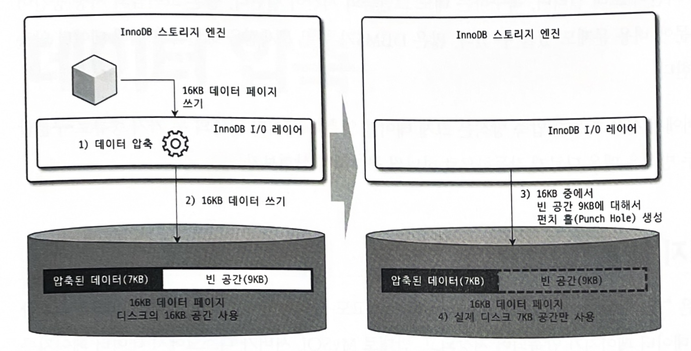
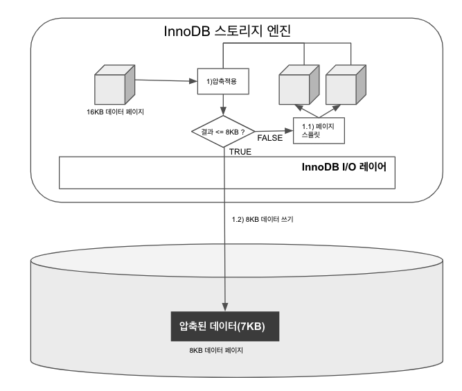

## 1. 페이지 압축
- MySQL 서버가 디스크에 저장하는 시점에는 데이터 페이지가 압축되어 저장되고 디스크에서 데이터 페이지를 읽어올 때 압축이 해제 된다
  - 즉 버퍼 풀에 데이터 페이지가 한 번 적재되면 InnoDB는 압축이 해제된 상태로만 데이터 페이지를 관리한다
- 여기서 문제점이 있는데 16KB 데이터 페이지를 압축한 결과가 용량이 얼마나 도리지 예측이 불가능한데 적어도 하나의 테이블은 동일한 크기의 페이지(블록)로 통일돼야 한다
  - 그래서 페이지 압축 기능은 운영체제의 파일 시스템에서만 지원되는 펀치 홀이라는 기능을 사용한다

>####  운영체제(파일 시스템)의 블록 사이즈가 512바이트인 경우 압축이 작동하는 방식
> 16KB 페이지를 압축(압축 결과를 7KB로 가정) <br>
> MySQL 서버는 디스크에 압축된 결과 7KB를 기록 (이때 MySQL 서버는 압축 데이터 7KB에 9KB 빈 데이터를 기록) <br>
> 디스크에 데이터를 기록한 후 9KB에 대해 펀치 홀을 생성 <br>
> 파일 시스템은 7KB만 남기고 나머지 9KB는 다시 운영체제로 반납 <br>
> 실제 디스크 공간은 7KB만 차지하지만 해당 데이터를 읽으면 펀치 홀 공간인 9KB를 합쳐서 16KB를 읽는다



- 문제는 운영체제뿐만 아니라 하드웨어 자체에서도 해당 기능을 지원해야 사용 가능하다는 점이다
- 또 다른 문제점은 아직 파일 시스템 관련 명령어(유틸리티)가 펀치 홀을 지원하지 못하다는 것이다
- 이런 이유로 실제 페이지 압축은 많이 사용되지 않는 상태다
- 페이지 압축을 이용하기 위해서는 테이블을 생성하거나 변경할 때 COMPRESSION 옵션을 설정하면 된다
  - `CREATE TABLE t1 (c1 INT) COMPRESSION="zlib";`

## 2. 테이블 압축
- 운영체제나 하드웨어에 대한 제약 없이 사용할 수 있기 때문에 활용도가 높다
- 디스크 데이터 파일 크기를 줄일 수 있기 때문에 이득은 있지만 단점도 있다
  - 버퍼 풀 공간 활용률이 낮다
  - 쿼리 처리 성능이 낮다
  - 빈번한 데이터 변경 시 압축률이 떨어진다

### 1. 압축 테이블 생성
- 압축을 사용하기 위해서 별도의 테이블 스페이스를 사용해야 한다
  - `innodb_file_per_table`이 ON으로 설정된 상태에서 테이블을 생성해야 한다
- 테이블 압축을 사용하는 테이블은 생성할 때 `ROW_FORMAT_COMPRESSED`옵션을 명시해야 하는데, 2n으로만 설정할 수 있다
- 페이지 크기가 16KB라면 `KEY_BLOCK_SIZE`는 4KB 또는 8KB만 설정할 수 있다
  - 페이지 크기가 32KB 또는 64KB인 경우에는 테이블 압축을 적용할 수 없다
  - `ROW_FORMAT`옵션이 생략되면 `ROW_FORMAT=COMPRESSED`로 추가되어 생성된다
- 목표 크기(KEY_BLOCK_SIZE)가 잘못 설정되면 처리 성능이 급격히 떨어질 수 있다

```sql
SET GLOBAL innodb_file_per_table=ON;

- // ROW_FORMAT 옵션과 KEY_BLOCK_SIZE 옵션을 모두 명시
CREATE TABLE compressed_table(c1 INT PRIMARY KEY)
  ROW_FORMAT=COMPRESSED
  KEY_BLOCK_SIZE=8;
```

>#### 압축을 적용하는 방법
> 1. 16kb의 데이터 페이지를 압축 <br>
> 1-1. 압축된 결과가 8KB 이하이면 그대로 디스크에 저장(압축 완료) <br>
> 1-2. 압축된 결과가 8KB 초과하면 원본 페이지를 스플릿해서 2개의 페이지에 8KB씩 저장 <br>
> 2. 나뉜 페이지 각각에 대해 1번 단계를 반복 실행



### 2. KEY_BLOCK_SIZE 결정
- 테이블 압축에서 가장 중요한 부분은 압추고딘 결과를 예측해서 `KEY_BLOCK_SIZE`를 결정하는 것이다
- 먼저 4KB 또는 8KB로 생성해서 저장해보고 판단하는 것이 좋다
- 압축 실패율이 높지 않더라도 데이터가 빈번하게 조회되고 변경된다면 압축은 고려하지 않는 것이 좋다
- 테이블 압축은 zlib를 이용해 압축을 실행하는데, 많은 CPU 자원을 소모한다는 것을 기억해두자