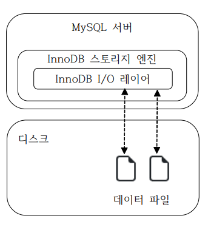
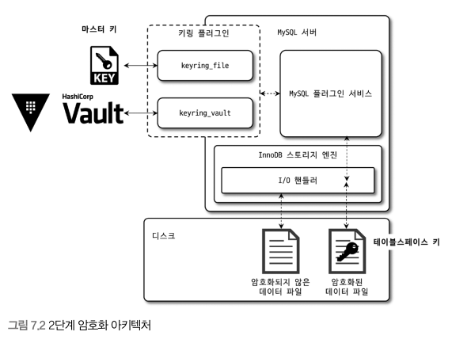

기존에는 데이터파일에 대해서만 암호화 기능이 제공됐지만 8.0이 되면서 리두 로그나 언두 로그, 복제를 위한 바이너르 로그 등도 모두 암호화 기능을 지원하기 시작했다

## 1. MySQL 서버의 데이터 암호화
- 암호화 기능은 데이터베이스 서버와 디스크 사이의 데이터 읽고 쓰기 지점에서 암호화 또는 복호화를 수행한다
  - 그래서 MySQL 서버에서 디스크 입출력 이외의 부분에서는 암호화 처리가 전혀 필요치 않다
  - 즉 MySQL 서버(InnoDB)의 I/O 레이어에서만 데이터 암호화 및 복호화 과정이 실행되는 것이다
- 쿼리에서 데이터가 암호화돼 있는지 여부를 식벽할 필요 없으며, 암호화된 테이블과 그렇지 않은 테이블이 동일한 처리 과정을 거친다
  - 이러한 암호화 방식을 가리켜 TDE(Transparent Data Encryption)이라고 한다



### 1. 2단계 키 관리
- MySQL 서버의 TDE에서 암호화 키는 키링 플러그인에 의해 곤리되며 커뮤니티 에디션은 `keyring_file`플러그인만 사용이 가능하다
  - keyring_file File-Based 플러그인
  - keyring_encrypted_file Keyring 플러그인
  - keyring_okv KMIP 플러그인
  - keyring_aws Amazon Web Servies Keyring 플러그인



- 데이터 암호화는 마스터 키와 테이블스페이스카 라는 두 가지 종류의 키를 가지고 있다
  - 테이블 스페이스 키는 프라이빗 키라고도 한다
  - MySQL 서버는 HashiCorp Vault 같은 외부 키 관리 솔루션 또는 디스크 파일(플러그인 사용시) 마스터 키를 가져오고, 암호화된 테이브링 생성될 때마다 해당 테이블을 위한 임의의 테이블 스페이스 키를 발급한다
  - 마스터 키를 이용해 테이블 스페이스 키를 암호화해서 각 테이블의 데이터 파일 헤더에 저장한다
  - 테이블 스페이스 키는 외부로 누출되지 않기 때문에 보안상 취약점이 되지 않는다
  - 마스터 키는 외부의 파일을 이용하기 때문에 노출될 가능성이 있어 주기적으로 변경해야 한다
  - 마스터 키 변경: `ALTER INSTANCE ROTATE INNODB MASTER KEY;`
- 마스터 키를 변경하면 각 테이블 스페이스 키를 다시 암호화해야 한다
- 암호화는 AES 256이 사용된다

### 2. 암호화와 성능
- 데이터 페이지가 메모리에 적재되면 암호화됮 않은 테이블과 동일한 성능을 보인다
- 하지만 디스크에서 읽어야 하는 경우에는 복호화를 해야하기 때문에 쿼리가 지연된다
  - 쓰기의 경우 백그라운드 스레드가 실행하기 때문에 실제 사용자 쿼리가 지연되지는 않는다
- 데이터 페이지는 암호화 키보다 훨씬 크기 때문에 데이터 파일의 크기는 동일해 버퍼 풀 효율이 떨어지는 현상은 벌어지지 않는다

### 3. 암호화와 복제
- 마스터 키가 레플리카로 복제되지 않기 때문에 테이블 스페이스 키 또한 레플리카로 복제되지 않는다
- 암호화된 데이터의 내용은 완전히 달라지게 된다

## 2. Keyring_file 플러그인 설치
- keyring_file 플러그인은 미스터 키를 디스크의 파일로 관리하는데, 이때 평문으로 저장하게 된다
- 설정 파일(my.cnf)에서 `early-plugin-load`시스템 변수에 keyring_file 플러그인을 위한 라이브러리를 명시하면 된다
- MySQL 서버가 2개 이상이라면 서로 다른 키링 파일을 사용하도록 해야 한다 (오직 하나의 파일이 하나의 서버를 담당)

## 3. 테이블 암호화
- 키링 플러그인은 마스터 키를 생성하고 관리하는 부분만 관리하기 때문에 어떤 키링을 사용하던 상관없이 활용하는 방법은 동일하다
### 1. 테이블 생성
- 일반적인 테이블 생성과 동일하며 `ENCRYPTION=Y`옵션만 추가로 넣으면 된다
- 암호화된 테이블만 검색할 때는 `information_schema`의 `TABLES` 뷰를 이용하면 된다
- 모든 테이블에 암호화를 적용하고 싶다면 `default_table_encryption`을 ON으로 설정하면 된다
```sql
CREATE TABLE tab_enrypted(id INT) ENCRYPTION='Y';
```

### 2. 응용 프로그램 암호화와의 비교
- 응용 프로그램에서 암호화해서 저장하는 경우에는 인덱스를 100% 활용할 수 없다
